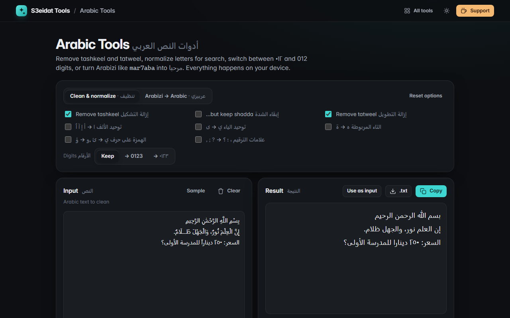

# Arabic Tools · أدوات النص العربي

> Remove tashkeel, fix digits, Arabizi to Arabic. Free, private, and it runs entirely in your browser.

### ▶ [Open Arabic Tools](https://s3eidat.github.io/arabic-tools/)



## Features

**Clean & normalize** (pick any combination, applied live):

- **Remove tashkeel / harakat**: fatha, damma, kasra, tanween, sukun, shadda (U+064B–U+0652), the superscript alef
  in words like هٰذا (U+0670), extended marks (U+0653–U+065F) and Quranic annotation signs. Option to **keep shadda**.
- **Remove tatweel** (ـ, U+0640)
- **Normalize** alef (أ إ آ ٱ → ا), ya (ى → ي), ta marbuta (ة → ه) and hamza seats (ؤ → و, ئ → ي), handy for search and matching
- **Digits**: Arabic-Indic ٠١٢٣ ⇄ Western 0123 (Persian ۰۱۲ digits are converted too)
- **Punctuation**: , ; ? → ، ؛ ؟

**Arabizi → Arabic**: turns chat-style Arabic (`mar7aba, kifak?`) into Arabic letters (مرحبا، كيفك؟) using
2=ء 3=ع 3'=غ 5=خ 6=ط 7=ح 8=ق 9=ص and sh/kh/gh/th/dh. Arabizi has no single standard, so the result is a best
guess (short vowels are dropped, long ones become ا و ي). A reference chart is on the page.

Also: Arabic letter, word and character counts, number of marks removed, copy, download `.txt`, bilingual labels and right-to-left text areas.

## Privacy

Your text never leaves your device. There is no server, no account, no analytics.
The page ships with a strict Content-Security-Policy (`connect-src 'self'`), so the browser
itself blocks any attempt to send data anywhere.

## Run it yourself

It's plain HTML, CSS and JavaScript with no build step:

```bash
git clone https://github.com/s3eidat/arabic-tools
cd arabic-tools
python -m http.server 8000
```

Then open http://localhost:8000.

## Support

If this saved you time, **[buy me a coffee ☕](https://s3eidat.github.io/coffee/)**. It keeps every tool free.

---

Part of **[S3eidat Tools](https://s3eidat.github.io/)**: 100+ free, private tools that run in your browser. MIT licensed.
